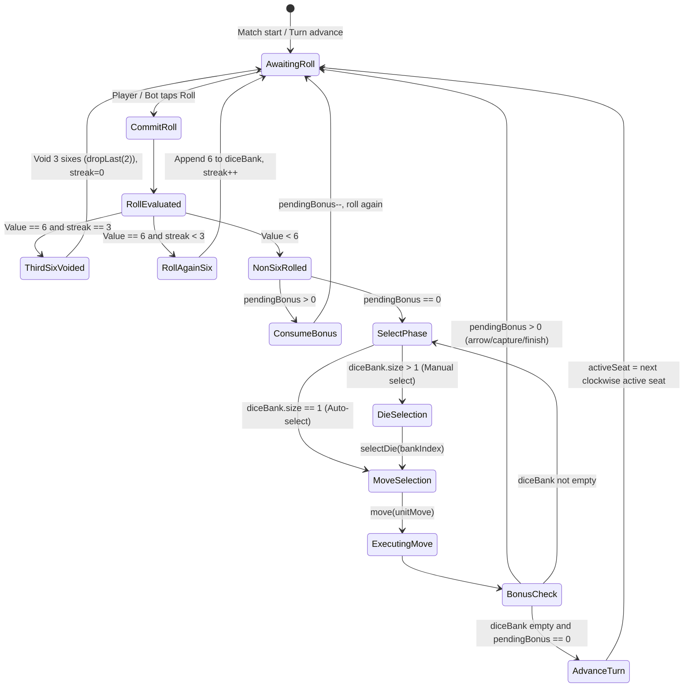
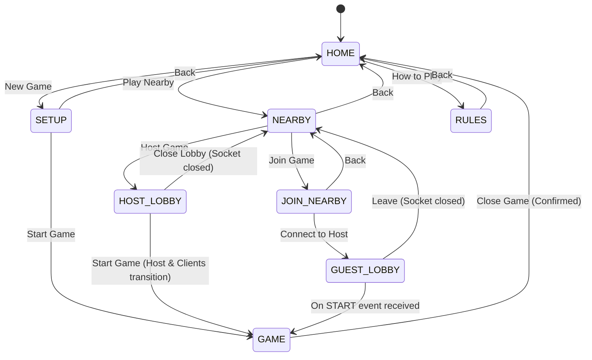

# Mummy Ludo — Deep Technical Reference

**Document Purpose**: Definitive technical reference for the Mummy Ludo Android codebase. Provides exhaustive algorithmic, mathematical, protocol, and architectural specifications for developers and agents.  
**Companion Document**: [Agent Handoff & Onboarding Guide](file:///Users/titan/.gemini/antigravity/brain/a7d6e891-efab-48ae-9e98-5f2727b9575f/agent_handoff.md)

---

## 1. LudoEngine Complete API Reference

Class: `com.mummyludo.app.game.LudoEngine(private val dice: () -> Int = { Random.nextInt(1, 7) })`  
The engine is a pure Kotlin, deterministic, immutable state machine.

### 1.1 Class Methods

#### `generateRoll(): Int`
- **Signature**: `fun generateRoll(): Int`
- **Preconditions**: None.
- **Returns**: An integer $r \in [1, 6]$ produced by the injected `dice` lambda.
- **Side Effects**: Enforces `require(it in 1..6)`. Advances the underlying RNG.

#### `newGame(seats: List<Seat>): GameState`
- **Signature**: `fun newGame(seats: List<Seat>): GameState`
- **Preconditions**:
  - `require(seats.size in 2..4)`
  - `require(seats.map { it.color }.distinct().size == seats.size)` (no duplicate colors).
- **Behavior**:
  - Sorts seats strictly according to `LudoColor.entries` clockwise order: `RED (0) -> GREEN (1) -> YELLOW (2) -> BLUE (3)`.
  - Generates 4 tokens per active seat with `progress = YARD (-1)` and indices `0..3`.
- **Returns**: A freshly initialized `GameState` with `turn = 1`, `awaitingRoll = true`, `activeSeat = 0`, `diceBank = emptyList()`.

#### `commitRoll(state: GameState, forced: Int? = null): GameState`
- **Signature**: `fun commitRoll(state: GameState, forced: Int? = null): GameState`
- **Preconditions**:
  - `check(state.roll == null && state.awaitingRoll && !state.completed)`
  - `forced?.let { require(it in 1..6) }`
- **Logic**:
  1. Resolves `value = forced ?: generateRoll()`.
  2. Resolves bonus consumption:
     `val consumesBonus = state.pendingBonus > 0 && state.consecutiveSixes == 0`  
     `val remainingBonus = state.pendingBonus - if (consumesBonus) 1 else 0`
  3. Evaluates 6-streak:
     `val streak = if (value == 6) state.consecutiveSixes + 1 else 0`
  4. **Third Consecutive 6 Handling**:
     If `streak == 3`:
     - Discards the streak: `diceBank = state.diceBank.dropLast(2)` (the 3rd six was not yet added to the bank).
     - Keeps `awaitingRoll = true`, `consecutiveSixes = 0`, sets `message = "Three sixes cancelled · roll again"`.
     - Preserves earlier non-six bank values and `remainingBonus`.
  5. **Normal Roll**:
     - Appends `value` to `diceBank`.
     - Sets `awaitingRoll = (value == 6 || remainingBonus > 0)`.
     - Updates message (`"Six rolled · roll again"`, `"Bonus roll"`, or `"Choose a dice value"`).
- **Returns**: The updated `GameState`.

#### `selectDie(state: GameState, bankIndex: Int): GameState`
- **Signature**: `fun selectDie(state: GameState, bankIndex: Int): GameState`
- **Preconditions**:
  - `check(!state.awaitingRoll && state.roll == null && bankIndex in state.diceBank.indices)`
- **Behavior**:
  - Extracts `value = state.diceBank[bankIndex]`.
  - Removes index from `diceBank`.
  - Sets `state.roll = value`.
  - Validates `legalMoves(selected)`. If no legal moves exist for this value, immediately invokes `finishMove()` with message `"No legal move for $value"`, discarding that die.
- **Returns**: `GameState` ready for token selection, or advanced if no move was possible.

#### `selectOnlyDie(state: GameState): GameState`
- **Signature**: `fun selectOnlyDie(state: GameState): GameState`
- **Preconditions**: None.
- **Behavior**: If `!state.awaitingRoll && state.roll == null && state.diceBank.size == 1`, calls `selectDie(state, 0)`. Otherwise returns `state` unchanged.

#### `legalMoves(state: GameState): List<UnitMove>`
- **Signature**: `fun legalMoves(state: GameState): List<UnitMove>`
- **Preconditions**: Returns `emptyList()` if `state.roll == null`.
- **Behavior**:
  1. Identifies active color's unfinished tokens (`progress != FINISHED`).
  2. Identifies existing pairs from `state.pairs` (`"sorted1:sorted2"`).
  3. Adds singles for all unpaired tokens.
  4. Identifies potential dynamic pairs: any 2 unpaired tokens sharing the same track square (`progress >= 0`). If 4 tokens share a square, groups them into 2 separate pairs.
  5. Filters legal moves:
     - Doubles can only move on even die (`die % 2 == 0`).
     - Route step distance: `die / 2` for doubles, `die` for singles.
     - Tokens in yard (`current == YARD (-1)`): can only move if `die == 6`, resulting in `UnitMove(enters = true, destination = 0, routeSteps = 0)`.
     - Move is illegal if `advanceProgress(current, steps) > FINISHED (57)`.
- **Returns**: Distinct list of `UnitMove(tokenIds, destination, routeSteps, enters)`.

#### `move(state: GameState, move: UnitMove): MoveResult`
- **Signature**: `fun move(state: GameState, move: UnitMove): MoveResult`
- **Preconditions**: `require(move in legalMoves(state))`
- **Execution Flow**:
  1. Computes `baseDestination = move.destination`.
  2. Resolves arrow: `arrowDestination = arrowHead(color, baseDestination)`.
  3. `destination = arrowDestination ?: baseDestination`.
  4. Updates token progress to `destination`.
  5. Updates `pairs`:
     - If moving unit is a pair and lands on an unprotected square (not `isProtected` and not `FINISHED`), updates `pairs += pairKey(move.tokenIds)`.
     - If landing on a protected square or `FINISHED`, pair is dissolved.
  6. Resolves captures: Calls `capturedAt()`. Captured tokens reset to `progress = YARD (-1)`. Any pairs involving captured tokens are dissolved.
  7. Auto-pairs collocated same-color tokens at destination if unprotected.
  8. Accumulates bonuses:
     `pendingBonus = state.pendingBonus + (if (arrow) 1 else 0) + (if (captured) 1 else 0) + (if (finished) 1 else 0)`.
  9. Evaluates rankings via `updateRanking()`.
  10. Concludes move via `finishMove()`.
- **Returns**: `MoveResult(state, capturedCount, arrowBool, baseDestination, finalDestination, movedTokenIds)`.

#### `chooseBest(state: GameState): UnitMove`
- **Signature**: `fun chooseBest(state: GameState): UnitMove`
- **Preconditions**: `legalMoves(state)` must not be empty.
- **Behavior**: Greedy evaluation heuristic selecting move with highest score:
  - Land exactly on `FINISHED (57)`: `+10,000`
  - Capture one or more opponents: `+8,000 + opponentCount`
  - Deep home lane (`destination > 51`): `+5,000 + destination`
  - Reach a protected square (`isProtected`): `+3,000`
  - Deploy from yard (`enters = true`): `+2,000`
  - Normal track advance: `destination` (progress value)
  - Tie-breaking: Lexicographical order of sorted `tokenIds`.

#### `autoStep(state: GameState, forcedRoll: Int? = null): GameState`
- **Signature**: `fun autoStep(state: GameState, forcedRoll: Int? = null): GameState`
- **Behavior**: Single execution step: rolls if awaiting roll, selects best die if in bank, and executes `chooseBest()` move. Returns immediately if `state.completed`.

#### `simulate(initial: GameState, seed: Int, maxTurns: Int = 50_000): GameState`
- **Signature**: `fun simulate(initial: GameState, seed: Int, maxTurns: Int = 50_000): GameState`
- **Behavior**: Runs a match to completion using a seeded `Random(seed)`. Throws `IllegalStateException` if `maxTurns` is exceeded.

---

### 1.2 Top-Level Engine Functions

#### `pairKey(ids: List<String>): String`
- Formats list of token IDs into a canonical sorted pair string, e.g., `listOf("R2", "R0") -> "R0:R2"`.

#### `globalTrack(color: LudoColor, progress: Int): Int`
- **Formula**:
  $$\text{globalIndex} = (\text{offset}[\text{color}] + \text{progress}) \pmod{52} \quad \text{for } \text{progress} \in [0, 51]$$
- Returns `-1` if `progress` is in yard (`-1`) or home lane / finished (`\ge 52`).

#### `isProtected(color: LudoColor, progress: Int): Boolean`
- Returns `true` if `progress in 0..51` and `globalTrack(color, progress)` is in:
  $$\text{protectedTrack} = \{0, 8, 13, 21, 26, 34, 39, 47\}$$

#### `arrowHead(color: LudoColor, progress: Int): Int?`
- **Home Entry Arrow**: If `progress == 48`, returns `52` (crosses into home lane).
- **Short Board Arrows**: If `progress in 0..51` and `globalTrack(color, progress)` is in:
  $$\text{shortArrowTails} = \{1, 4, 14, 17, 27, 30, 40, 43\}$$
  returns `progress + 1`.
- Otherwise returns `null`.

#### `advanceProgress(current: Int, steps: Int): Int`
- **Formula**:
  $$\text{raw} = \text{current} + \text{steps}$$
  $$\text{advanceProgress} = \begin{cases} \text{raw} + 1 & \text{if } \text{current} \le 50 \text{ and } \text{raw} \ge 51 \\ \text{raw} & \text{otherwise} \end{cases}$$
- **Rationale**: Track step 50 is the last shared square before turning into the home lane. The home lane starts at index 52. Step 51 is bypassed.

#### `movementAnimationProgresses(start: Int, baseDestination: Int, finalDestination: Int, enters: Boolean, arrow: Boolean): List<Int>`
- Calculates step-by-step waypoint integers for UI rendering. Skips progress 51 unless an arrow dictates otherwise.

---

## 2. GameState — Field-by-Field Reference

```kotlin
data class GameState(
    val seats: List<Seat>,
    val tokens: List<Token>,
    val pairs: Set<String> = emptySet(),
    val activeSeat: Int = 0,
    val pendingBonus: Int = 0,
    val consecutiveSixes: Int = 0,
    val diceBank: List<Int> = emptyList(),
    val awaitingRoll: Boolean = true,
    val roll: Int? = null,
    val ranking: List<LudoColor> = emptyList(),
    val turn: Int = 1,
    val message: String = "Roll the dice",
    val completed: Boolean = false,
)
```

| Field | Type | Description & Lifecycle |
|---|---|---|
| `seats` | `List<Seat>` | Active seats in clockwise order: Red, Green, Yellow, Blue. Contains participant type (`HUMAN`/`BOT`) and display name. |
| `tokens` | `List<Token>` | $4 \times N$ tokens ($N = \text{seats.size}$). Each token has `color`, `index` ($0..3$), and `progress` ($-1..57$). |
| `pairs` | `Set<String>` | Active paired doubles on non-protected track squares. Encoded via `pairKey()` as `"sortedId1:sortedId2"` (e.g. `"R0:R1"`). Dissolved upon reaching safe squares or yard. |
| `activeSeat` | `Int` | Zero-based index into `seats` pointing to the player whose turn it is. |
| `pendingBonus` | `Int` | Accumulated bonus rolls owed to the active player from arrows (`+1`), captures (`+1`), or finishes (`+1`). Decremented when rolling without sixes. |
| `consecutiveSixes`| `Int` | Counter for sequential sixes rolled in current turn ($0, 1, 2$). Reaching 3 resets counter to 0 and drops two sixes from `diceBank`. |
| `diceBank` | `List<Int>` | FIFO queue of committed die values ($1..6$) rolled this turn waiting to be assigned to moves. |
| `awaitingRoll` | `Boolean` | `true` if player must roll (turn start, rolled a 6, or `pendingBonus > 0`). `false` when player must select a die or move. |
| `roll` | `Int?` | The currently selected die value actively generating `legalMoves()`. `null` when rolling or when multiple unselected dice exist in `diceBank`. |
| `ranking` | `List<LudoColor>`| Chronological list of finished players. First entry is 1st place winner. When only 1 player remains unfinished, they are automatically placed last. |
| `turn` | `Int` | Monotonically increasing round counter. Incremented each time the turn advances to the next seat. |
| `message` | `String` | Status string displayed on the UI top bar and game controls (e.g. `"Roll the dice"`, `"Six rolled · roll again"`, `"Red captured 1"`). |
| `completed` | `Boolean` | `true` when all seats or all-but-one seats have finished and rankings are finalized. Triggers confetti and disables input. |

---

## 3. Token Progress Space

The progress coordinate is an integer spanning $-1$ to $57$:

```
[-1] YARD 
  │ (Requires 6 to enter)
  ▼
[ 0] START SQUARE (Protected)
  │
  │  (Shared track: 0 to 51)
  ▼
[48] HOME ENTRY ARROW TAIL ──(via arrow)──► [52] HOME LANE BLOCK 1
  │                                          │
[50] LAST TRACK BLOCK                        │
  │                                          │
  └──(advanceProgress skips 51)──────────────► [52] HOME LANE BLOCK 1
                                               │
                                             [53] HOME LANE BLOCK 2
                                               │
                                             [54] HOME LANE BLOCK 3
                                               │
                                             [55] HOME LANE BLOCK 4
                                               │
                                             [56] HOME LANE BLOCK 5
                                               │ (Exact roll required)
                                               ▼
                                             [57] FINISHED (Center)
```

- **Global Offset Mapping**:
  $$\text{Red} \to 0, \quad \text{Green} \to 13, \quad \text{Yellow} \to 26, \quad \text{Blue} \to 39$$
- **Yard Deployment**: Roll of 6 moves token from `progress = -1` to `progress = 0`. This is considered a deployment (`enters = true`, `routeSteps = 0`).

---

## 4. Capture Matrix (Full Invariant Specification)

Captures are resolved in `capturedAt()` when an attacker lands on an unprotected track square $p \in [0, 51]$.

```kotlin
fun capturedAt(attacker: LudoColor, destination: Int, attackingCount: Int, tokens: List<Token>, pairs: Set<String>): Set<String>
```

### Detailed Resolution Rules:
1. **Single Attacker (`attackingCount == 1`)**:
   - Defender = 1 Single: **Captured**.
   - Defender = 2 (1 Pair): **No Capture** (single cannot penetrate double).
   - Defender = 3 (1 Pair + 1 Single): **Single Captured**; pair remains untouched.
   - Defender = 4 (2 Pairs): **No Capture**.
2. **Double Attacker (`attackingCount == 2`)**:
   - Defender = 1 Single: **Captured**.
   - Defender = 2 (1 Pair): **Both Captured**.
   - Defender = 3 (1 Pair + 1 Single): **Pair Captured** (2 tokens returned to yard); single remains untouched.
   - Defender = 4 (2 Pairs): **All 4 Captured** in a single capture event.
3. **Protected Squares**:
   If `isProtected(color, destination) == true`, `capturedAt` is bypassed entirely. All colors coexist peacefully.

---

## 5. Arrow System

The board features two categories of arrows:

### 5.1 Short Track Arrows
- Physical track shortcuts spanning 2 blocks (from tail to immediately following block).
- Tail positions are defined by global track indices:
  $$\text{shortArrowTails} = \{1, 4, 14, 17, 27, 30, 40, 43\}$$
- When any token lands on an arrow tail, `arrowHead()` returns `progress + 1`.
- **Bonus**: Grants $+1$ `pendingBonus`.

### 5.2 Home-Entry Arrows
- Starts at color-relative progress `48` (after the 4th star protected square).
- Follows a 4-block path directly into the first cell of that color's home lane (`progress = 52`).
- `arrowHead(color, 48)` returns `52`.
- **Bonus**: Grants $+1$ `pendingBonus`. If arrival at the head also captures, the player receives $+2$ pending bonus rolls in total ($+1$ for arrow, $+1$ for capture).

---

## 6. Dice Bank & Bonus Flow State Machine



---

## 7. Pairs / Doubles System

1. **Formation**:
   - Explicit pairs in state: `pairs: Set<String>`.
   - Dynamic pairs: In `legalMoves()`, any two same-color tokens sharing a progress cell $\ge 0$ can be selected together as a double move.
2. **Movement Constraints**:
   - Doubles **only move on even rolls** ($2, 4, 6$). Odd rolls ($1, 3, 5$) return `null` in legal move generation.
   - Travel distance is halved: $\text{steps} = \text{die} / 2$.
     - Roll 2 $\to$ 1 step.
     - Roll 4 $\to$ 2 steps.
     - Roll 6 $\to$ 3 steps.
3. **Protected Square Splitting**:
   - When a double lands on a protected square ($0, 8, 13, 21, 26, 34, 39, 47$), `pairs = pairs.filterNot { ... }` dissolves the pair.
   - The tokens sit as individual singles. On any future even roll, they can be re-paired and moved together.
4. **Passage**:
   - Doubles are not blockades; other tokens and doubles can pass through them freely.

---

## 8. Nearby Wire Protocol Specification

Transport: Plain TCP sockets on port `42871`.  
Framing: Line-delimited (`\n`). Fields separated by pipe (`|`).  
Encoding: All arbitrary string fields are encoded with `Base64.getUrlEncoder().withoutPadding()`.

### 8.1 Client-to-Host Messages

| Command | Format | Field Breakdown |
|---|---|---|
| **JOIN** | `JOIN\|<token>\|<playerId>\|<name>` | `token`: Base64 join token.<br>`playerId`: Base64 UUID.<br>`name`: Base64 initial player name. |
| **PROFILE** | `PROFILE\|<playerId>\|<name>\|<color>\|<ready>` | `playerId`: Base64 UUID.<br>`name`: Base64 updated name.<br>`color`: Color enum name (`RED`, etc.) or `-`.<br>`ready`: Literal `true` or `false`. |
| **ACTION** | `ACTION\|<encodedAction>` | `encodedAction`: Base64 encoded action string: `ROLL`, `DIE\|<index>`, `MOVE\|<id1,id2>`. |

### 8.2 Host-to-Client Messages

| Command | Format | Field Breakdown |
|---|---|---|
| **LOBBY** | `LOBBY\|<record1>;<record2>;...` | Each record: `<b64Id>,<b64Name>,<isHostBool>,<COLOR_OR_DASH>,<readyBool>`. |
| **START** | `START\|<seat1>;<seat2>;...` | Each seat: `<COLOR>,<b64Name>,<isBotBool>`. Sorted by color ordinal. |
| **EVENT** | `EVENT\|<encodedEvent>` | Base64 encoded payload: `<sequence>~<rollValueOrDash>~<actionString>`. |
| **ERROR** | `ERROR\|<message>` | `message`: Base64 human-readable error string. |

### 8.3 Action and Event Encodings
- **Roll Action**: `ROLL`
- **Select Die Action**: `DIE|<bankIndex>` (e.g. `DIE|0`)
- **Move Action**: `MOVE|<id1,id2>` (e.g. `MOVE|R0,R1` or `MOVE|G2`)
- **Event Tuple**: `sequence~rollValue~action`
  - Example Roll Event: `1~5~ROLL`
  - Example Move Event: `2~-~MOVE|R0`

---

## 9. Navigation State Machine

Implemented in [`MummyLudoApp.kt`](file:///Users/titan/Documents/MummyLudo/app/src/main/java/com/mummyludo/app/MummyLudoApp.kt):

```kotlin
private enum class Page { 
    HOME, SETUP, GAME, RULES, NEARBY, HOST_LOBBY, JOIN_NEARBY, GUEST_LOBBY 
}
```



### BackHandler Specifications:
- `Page.HOME`: Double-back to exit. Displays `"Press back again to exit"` Toast; exits app if repeated within $2,000\text{ ms}$.
- `Page.SETUP`, `Page.RULES`, `Page.NEARBY`: Reverts to `Page.HOME`.
- `Page.HOST_LOBBY`: Closes server socket (`hostSession?.close()`), clears lobby, reverts to `Page.NEARBY`.
- `Page.GUEST_LOBBY`: Closes client socket (`clientSession?.close()`), clears lobby, reverts to `Page.NEARBY`.
- `Page.GAME`: `BackHandler(enabled = !showClose) { showClose = true }`. Back button triggers the close match dialog.

---

## 10. DiceRollPath Mathematical Specification

Implemented in [`DiceRollPath.kt`](file:///Users/titan/Documents/MummyLudo/app/src/main/java/com/mummyludo/app/game/DiceRollPath.kt). Computes 2D trajectory and rotation as a function of normalized time $t \in [0, 1]$:

### 10.1 Equations of Motion

$$\text{Drift}(t) = \sin(4\pi t + \phi) \cdot W$$
$$x(t) = x_{\text{start}} + (x_{\text{end}} - x_{\text{start}}) \cdot t + \text{Drift}(t)$$

$$\text{Hop}(t) = \sin(\pi t) \cdot A$$
$$\text{Jitter}(t) = \sin(9\pi t + \phi) \cdot W \cdot 0.45$$
$$y(t) = y_{\text{start}} + (y_{\text{end}} - y_{\text{start}}) \cdot t - \text{Hop}(t) + \text{Jitter}(t)$$

$$\text{Rotation}(t) = 720^\circ \cdot t + \sin(8\pi t + \phi) \cdot 18^\circ$$

Where:
- $t \in [0.0, 1.0]$: Normalized animation progress.
- $A$: Arc height parameter (`arc`, range $34..86$).
- $W$: Lateral wobble amplitude (`wobble`, range $6..24$).
- $\phi$: Initial phase angle (`phase`, range $[0, 2\pi]$).
- Total rotation spans 2 complete tumbling revolutions ($720^\circ$) plus harmonic wobble ($\pm 18^\circ$).

---

## 11. Build & Dependency Configuration

Configured in [`app/build.gradle.kts`](file:///Users/titan/Documents/MummyLudo/app/build.gradle.kts):

- **Android SDKs**: `compileSdk = 36`, `minSdk = 26`, `targetSdk = 36`.
- **Application ID**: `com.mummyludo.app` (`.debug` for debug builds).
- **Versioning**: `versionCode = 4`, `versionName = "0.2.2"`.
- **Key Dependencies**:
  - `androidx.compose:compose-bom:2026.03.01`
  - `com.google.android.play:app-update:2.1.0` & `app-update-ktx:2.1.0`
  - `com.google.zxing:core:3.5.3` & `com.journeyapps:zxing-android-embedded:4.3.0`
  - `junit:junit:4.13.2` & `org.robolectric:robolectric:4.17`
- **JaCoCo Configuration**:
  ```kotlin
  tasks.withType<Test>().configureEach {
      extensions.configure<JacocoTaskExtension> {
          isIncludeNoLocationClasses = true
          excludes = listOf("jdk.internal.*")
      }
  }
  ```

---

## 12. LudoBoard Coordinate System & Layout

Implemented in [`LudoBoard.kt`](file:///Users/titan/Documents/MummyLudo/app/src/main/java/com/mummyludo/app/LudoBoard.kt).

### 12.1 Grid System
- Board is an exact $15 \times 15$ grid.
- Dimension unit: $\text{cell} = \frac{\text{boardWidth}}{15}$.

### 12.2 Track Geometry (52 Cells)
Defined as a continuous list of $(col, row)$ pairs starting at Red's entry $(1, 6)$ and running clockwise:
```kotlin
private val track = listOf(
    1 to 6,  2 to 6,  3 to 6,  4 to 6,  5 to 6,  6 to 5,  6 to 4,  6 to 3,  6 to 2,  6 to 1,  6 to 0,
    7 to 0,  8 to 0,  8 to 1,  8 to 2,  8 to 3,  8 to 4,  8 to 5,  9 to 6, 10 to 6, 11 to 6, 12 to 6,
   13 to 6, 14 to 6, 14 to 7, 14 to 8, 13 to 8, 12 to 8, 11 to 8, 10 to 8,  9 to 8,  8 to 9,  8 to 10,
    8 to 11, 8 to 12, 8 to 13, 8 to 14, 7 to 14, 6 to 14, 6 to 13, 6 to 12, 6 to 11, 6 to 10,
    6 to 9,  5 to 8,  4 to 8,  3 to 8,  2 to 8,  1 to 8,  0 to 8,  0 to 7,  0 to 6
)
```

### 12.3 Home Lanes
The 5 colored home blocks occupy row or column 7 (center lane of each arm):
- **RED**: $(1..5, 7)$
- **GREEN**: $(7, 1..5)$
- **YELLOW**: $(13\text{ down to } 9, 7)$
- **BLUE**: $(7, 13\text{ down to } 9)$

### 12.4 Yard Pawn Placements
Each 6×6 yard corner contains a rounded white inset home (occupying $1.1..4.9$ cells) with 4 pawn circles at offsets:
$$(2.2, 2.2), \quad (3.8, 2.2), \quad (2.2, 3.8), \quad (3.8, 3.8)$$

### 12.5 Multiple Pawn Spread Offsets
When multiple tokens of the same color share a cell, they spread across sub-pixel offsets:
- 1 Token: Offset $(0, 0)$
- 2 Tokens: Left $(-0.17, 0)$, Right $(+0.17, 0)$
- 3 Tokens: Bottom-Left $(-0.17, +0.13)$, Bottom-Right $(+0.17, +0.13)$, Top-Center $(0, -0.16)$
- 4 Tokens: 4 Quadrants $(-0.16, -0.14)$, $(+0.16, -0.14)$, $(-0.16, +0.16)$, $(+0.16, +0.16)$
