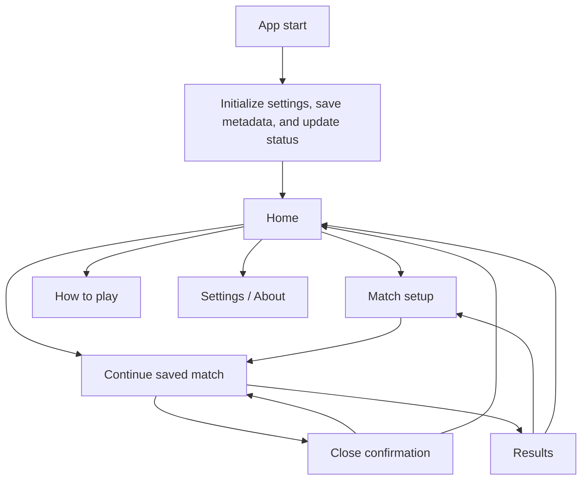
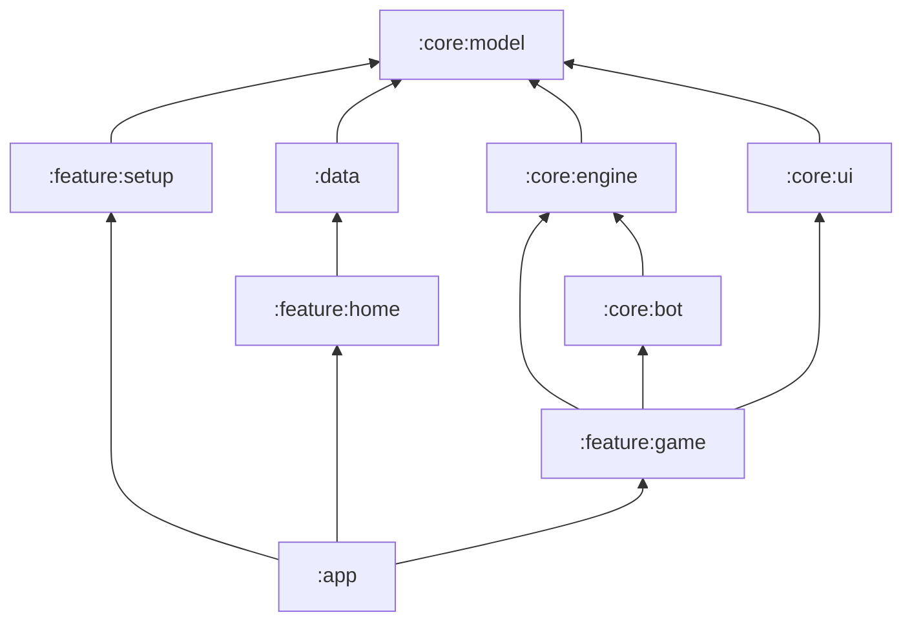

# Mummy Ludo — Android design and engineering specification

Status: approved engineering baseline — first playable build implemented
Depends on: [Product plan](./product-plan.md)
Target: Android 8.0+ (API 26), portrait-first, local/offline-first

This document translates the approved product plan into screen behavior, component contracts, game-engine boundaries, persistence, package structure, and verification work. Product rules remain authoritative when wording differs; implementation must not silently invent a new rule.

## 1. Design goals

1. **Start quickly.** A returning player can resume with one tap; a new match reaches the setup screen with one tap.
2. **Make the current action obvious.** At any point the UI emphasizes only the active color, die action, and legal tokens.
3. **Feel modern but familiar.** The board remains recognizably Ludo while using restrained color, light dividers, soft depth, and compact motion.
4. **Make fairness visible.** Dice are committed before moves, bots use the same legal-move list as humans, and update or restore operations never silently change a match.
5. **Remain usable offline.** Gameplay, rules, saves, bot decisions, and settings require no network.
6. **Scale down cleanly.** The complete board and core controls fit a 320 dp-wide content area without horizontal scrolling.

## 2. Navigation and screen graph

Use a single-activity Compose application. Navigation destinations contain serializable IDs only; the authoritative match remains in the game repository and engine.



Routes:

```text
home
setup
game/{matchId}
how-to-play
settings
results/{matchId}
```

Navigation rules:

- Home is the only normal start destination.
- A valid saved match never launches directly into play; Home shows **Continue game** so restoration is explicit.
- Back from Game behaves like Close: it opens a discard confirmation rather than a Pause screen.
- Confirming Close discards the active match and returns Home; cancelling remains on the board.
- Results removes Game from the back stack to prevent returning to a completed match.

### 2.1 Complete page and overlay catalog

The app has six user-navigable pages. Everything else is a temporary state or overlay so players do not lose the match context.

| Page | Route | Main purpose | Primary action |
|---|---|---|---|
| Home | `home` | Start, continue, see save/update status | Continue game or New game |
| Match setup | `setup` | Choose humans, colors, bots, and review the fixed rules | Start game |
| Game board | `game/{matchId}` | Roll, select tokens, follow progress, or close the match | Roll dice or Choose a token |
| How to play | `how-to-play` | Explain movement, arrows, safe squares, doubles, captures, sixes, and finishing | Back |
| Settings & About | `settings` | Sound, haptics, theme, update status, version, privacy, and licenses | Save automatically / Back |
| Results | `results/{matchId}` | Show the complete ranking and match summary | Play again or Home |

App start briefly shows the Android launch screen while initialization runs; it is not a navigable app page. The immediate-update flow is owned by Google Play and is likewise not represented as an app destination.

Important in-context overlays and states:

| State or overlay | Appears over | Behavior |
|---|---|---|
| Token-group selector | Game | Lists singles and doubles sharing a square; enables only legal movement units |
| Rules summary sheet | Setup | Shows the fixed V1 rules without leaving setup |
| Close confirmation | Game | Explains that closing discards the active match; Cancel stays on the board and Close returns Home |
| Save recovery | Home | Explains failed migration and offers a safe retry while preserving the original save |
| Flexible-update status | Home or Settings | Shows download progress and Restart to update without blocking play |
| Rank notification | Game | Briefly announces a participant's rank, then continues until one remains |

The Game destination has six visually distinct action states: human awaiting roll, dice animating, human choosing a token, bot rolling/thinking, bonus roll available, and match/rank resolution. These are states of one page, not separate routes. Local human turns advance directly on the same visible board; there is no handoff state.

## 3. Visual system

### 3.1 Color

Use four semantic Ludo colors, each with strong, soft, and content variants. These are domain colors, not general-purpose Material theme colors.

```text
LudoRed / LudoRedSoft / OnLudoRed
LudoGreen / LudoGreenSoft / OnLudoGreen
LudoYellow / LudoYellowSoft / OnLudoYellow
LudoBlue / LudoBlueSoft / OnLudoBlue
```

Requirements:

- Yellow must remain visibly yellow, not orange.
- Large yards use softened colors; tokens and active indicators use stronger colors.
- Track, text, settings, dialogs, and navigation use Material theme roles.
- The board always has four color seats in the fixed clockwise turn order **Red → Green → Yellow → Blue**. Red is opposite Yellow; Green is opposite Blue.
- Verify text and icons against both light and dark theme contrast targets.

### 3.2 Type and spacing

- Material 3 typography with system font; no downloaded font is required for V1.
- Use `headlineMedium` only for the Home greeting and result winner.
- Use `titleLarge` for screen titles, `titleMedium` for section titles, and `bodyMedium` for explanations.
- Minimum interactive target: 48 dp.
- Base spacing scale: 4, 8, 12, 16, 24, and 32 dp.
- Screen horizontal padding: 20 dp at compact width, 24 dp at medium width.

### 3.3 Shape and elevation

- Board outer radius: 14–18 dp depending on rendered size.
- Primary and secondary buttons: Material large shape.
- Home and setup content use no more than one elevated surface per visual group.
- Use tonal surfaces and dividers before adding shadows.

### 3.4 Motion and feedback

- Pawn movement advances one logical cell at a time, 80–110 ms per cell, capped so long moves do not feel slow.
- Capture: a short impact at the captured square, reverse cell-by-cell travel to the captured color's starting square, then one straight fixed-size movement into the exact yard circle. The moving pawn crossfades into the yard pawn at identical coordinates with no overshoot or resizing.
- Legal pawn emphasis: one restrained pulse cycle, then a steady ring.
- Dice: the committed value is generated before animation begins. A transient die then travels across the board, rolls through intermediate faces for 800–950 ms, settles on the committed face for 350–500 ms, and disappears.
- Haptics: light tick for dice, selection for pawn, success for finish, warning for third-six cancellation.

## 4. Home (landing) screen

### 4.1 Purpose

Home answers three questions immediately:

1. Can I continue a match?
2. How do I start a new match?
3. Is the app ready, offline, or waiting for an update restart?

### 4.2 Layout hierarchy

From top to bottom:

1. Status-bar-safe top row: Mummy Ludo wordmark and Settings icon.
2. Compact brand illustration: four pawn shapes around a die/center motif.
3. Greeting: **Ready for a game?**
4. Supporting line: **Offline play · fair bots · 1–4 players**.
5. Saved-match section, present only when a validated save exists:
   - **Continue game** as the dominant action.
   - Supporting metadata: active color, participant count, bot count, and saved time.
   - A compact four-color progress strip showing finished tokens.
6. Full-width **New game** button.
7. Two quiet actions: **How to play** and **Settings**.
8. Optional update state at the bottom: availability, progress, or **Restart to update**. It never replaces the game actions.

### 4.3 Home states

| State | Behavior |
|---|---|
| Fresh install | Hide Continue; New game is the dominant action |
| Valid saved match | Continue is first and dominant; New game remains available |
| Save migration running | Show non-interactive migration status; do not expose Continue |
| Save migration failed | Show recovery action and preserve original save |
| Flexible update downloading | Show compact progress without blocking New/Continue |
| Update downloaded | Show persistent Restart to update action |
| Offline / Play unavailable | Do not show an error on Home unless the user explicitly checks for updates |

### 4.4 Home component contract

```kotlin
data class HomeUiState(
    val savedMatch: SavedMatchSummary?,
    val saveStatus: SaveStatus,
    val updateState: UpdateUiState,
    val isBusy: Boolean
)

sealed interface HomeAction {
    data object NewGame : HomeAction
    data object ContinueGame : HomeAction
    data object HowToPlay : HomeAction
    data object OpenSettings : HomeAction
    data object CompleteUpdate : HomeAction
    data object RetryMigration : HomeAction
}
```

Home rendering is stateless: it emits actions and never opens repositories, starts updates, or restores games directly.

## 5. Match setup design

Use one vertically scrolling setup screen with progressive disclosure rather than a multi-page wizard. A sticky bottom bar contains the current summary and **Start game**.

### 5.1 Sections

1. **Players:** segmented choice for Solo, 2, 3, or 4 humans.
2. **Colors per player:** One color or Two colors; visible only for Solo/2 humans.
3. **Human assignments:** name and available color/pair.
4. **Bots:** mandatory opposite assignment in Solo one-color; optional remaining bots; bot names generated locally and editable later if desired.
5. **Rules summary:** compact link/sheet showing the fixed V1 preset.
6. **Match summary:** humans, bots, active seats, opening color, and token count per participant.

### 5.2 Validation

- Solo cannot start without a bot.
- Solo one-color automatically assigns the mandatory opposite bot: Red ↔ Yellow, Green ↔ Blue.
- Two-color ownership permits only Red+Yellow or Green+Blue.
- No color seat may have multiple owners.
- Start remains disabled until every human is named, required bot assignment exists, and at least two participants are present.
- Red is the anchor from which the opening turn is found, but Red does not have to be occupied. At match start the engine scans **Red → Green → Yellow → Blue** and gives the opening turn to the first active seat. For example, a Blue-versus-Green match opens with Green. Later turns continue in the same clockwise sequence while skipping inactive seats.

### 5.3 Setup state

```kotlin
data class SetupUiState(
    val humanCount: Int,
    val colorMode: ColorMode,
    val humans: List<EditableHuman>,
    val bots: List<EditableBot>,
    val availableColors: Set<LudoColor>,
    val validation: SetupValidation,
    val preview: MatchConfigPreview
)
```

All setup transitions are pure functions so the full configuration matrix can be JVM-tested without Compose.

## 6. Game screen design

### 6.1 Portrait layout

```text
┌─────────────────────────────┐
│ Active player · rank/status │
│ opponent progress strip     │
├─────────────────────────────┤
│                             │
│      square Ludo board      │
│   transient rolling die     │
│                             │
├─────────────────────────────┤
│ event message / bonus rolls │
│       primary action        │
└─────────────────────────────┘
```

- Board receives the maximum square size after reserving status and the action button.
- At compact height, collapse opponent details into one horizontal progress strip.
- The die is not permanently displayed below the board. It appears temporarily as an animation layer over the board only while a roll is resolving.
- Close is an `X` icon in the top app bar, never over the board. It opens only the discard confirmation, not a pause menu.

### 6.2 Dice and action area

- On a human turn, show a full-width **Roll dice** button directly below the event line. The button remains easy to reach with one hand, but the die itself is not shown beside or above it while idle.
- The line above the button identifies the active participant and action, for example **Your turn · Roll the dice** or **Bonus roll 1 of 2**.
- Keep this action area to one primary status line plus the optional bonus-roll count. Hide the bonus label when the count is zero. Do not show explanatory subtitles such as **Choose one of 2 legal tokens** or bot decision details; the token highlights, die face, and main action label already communicate those states.
- Commit the die value before animation. During the 800–950 ms animation, disable the button and ignore repeated taps.
- Create the die only as a transient overlay above the board. It enters from one side, rolls and tumbles across several board regions with visible bounces and rapidly changing faces, then settles near the board center with a soft landing shadow. It must not remain parked at the bottom of the screen.
- Hold the committed final face over the board for approximately 350–500 ms, then remove the die before enabling token selection or continuing the bot turn. The final face must match the committed result; intermediate faces are presentation-only.
- After the temporary die disappears, replace the button label with **Choose a token** when more than one move is legal and emphasize only legal tokens on the board.
- With one legal move, remove the die and then perform the configured automatic move. With no legal move, remove the die and show **No legal move** before resolving bonuses or advancing the turn.
- On a bot turn, the same area is non-interactive and reads only **[Bot name] is rolling…** or **[Bot name] is choosing…**, with no secondary explanation. Bots use the same committed roll, legal-move list, and reducer commands as humans.
- Each pending bonus consumes one separate roll. The action line displays the remaining count so a capture plus six is visibly represented as two bonus rolls.
- In landscape or large-width layouts, move this action area to a compact rail to the right of the square board; its state and order remain unchanged.

### 6.3 Board rendering layers

Render with one Compose `Canvas` for stable geometry plus composable overlays only for interactive tokens.

Layer order:

1. Yard fills and inset homes.
2. Track cells and home lanes.
3. Center finish triangles.
4. Protected stars and direction arrows.
5. Non-interactive tokens.
6. Legal-token rings and active animations.
7. Transient rolling-die overlay, present only during roll animation and result reveal.
8. Interaction hit-target overlays.

`BoardGeometry` owns every coordinate. The renderer receives geometry; it does not recalculate routes.

#### 6.3.1 Approved board visual baseline

The implementation must reproduce the approved modern board rather than substitute a generic Ludo grid:

- Perfect 15×15 square with rounded outer clipping, restrained dividers, and no heavy dark frame.
- Red yard: top-left and the opening-order anchor.
- Green yard: top-right and second clockwise seat.
- Yellow yard: bottom-right and third clockwise seat.
- Blue yard: bottom-left and fourth clockwise seat.
- Yellow is a true yellow and must not drift toward orange or brown.
- Each yard is a solid softened color with a contrasting rounded inset home and four large pawn positions; track grid lines do not continue through yards.
- The center is one square divided into four clean triangular color regions.
- Starting squares and protected stars remain visible beneath or beside tokens.
- Short direction arrows use thin strokes, start on the approved first and fourth post-start blocks, and finish in the immediately following block.
- Each home-entry arrow starts after the protected star and follows the approved four-block route to the first home-lane block.
- Arrows guide the path without becoming the strongest visual element.
- All yards, track cells, starts, stars, lanes, arrows, token centers, and animation bounds derive from the same `BoardGeometry` coordinate source.
- The dice animation is a temporary layer over this board. The idle, move-selection, and bot-decision states contain no persistent die graphic.

### 6.4 Token groups and crowded squares

- One token: normal pawn and one selectable movement unit.
- Two same-color tokens may render as one visibly paired double and act as one selectable movement unit.
- Three same-color tokens: one double plus one single. Four: two separate doubles.
- More than two tokens never form one unit.
- On protected squares with several colors or units, use a segmented marker plus total count when the individual pawns no longer fit.
- Tap opens a bottom sheet grouped by color and unit. Enable only legal singles or doubles for the committed die.

### 6.5 Turn UI state machine

```mermaid
stateDiagram-v2
    [*] --> AwaitingRoll
    AwaitingRoll --> AnimatingDice: Roll committed
    AnimatingDice --> RevealingDie: Board roll completes
    RevealingDie --> AwaitingMove: Die removed; multiple legal moves
    RevealingDie --> AutoMoveDelay: Die removed; one legal move
    RevealingDie --> ResolvingTurn: Die removed; no legal move
    AutoMoveDelay --> AnimatingMove: Delay completes
    AutoMoveDelay --> AwaitingMove: Player cancels auto move
    AwaitingMove --> AnimatingMove: Select legal token
    AnimatingMove --> ResolvingTurn
    ResolvingTurn --> AwaitingRoll: Bonus roll remains
    ResolvingTurn --> AwaitingRoll: Next color is human
    ResolvingTurn --> BotThinking: Next color is bot
    BotThinking --> AnimatingDice
```



UI phases block duplicate input. The reducer remains authoritative and can reject a stale command by revision.

## 7. Game-engine design

### 7.1 Core principle

The engine is a pure Kotlin deterministic state machine. Given `GameState + GameCommand`, it returns either a rejected command or `new GameState + GameEvents`. It has no Android, Compose, database, clock, or network dependency.

```kotlin
interface GameEngine {
    fun dispatch(state: GameState, command: GameCommand): Transition
}

data class Transition(
    val state: GameState,
    val events: List<GameEvent>
)
```

### 7.2 Commands

```text
StartMatch(config)
CommitRoll(expectedRevision)
MoveUnit(tokenIds, expectedRevision) // one token or one same-color pair
CancelAutoMove(expectedRevision)
CloseMatch(expectedRevision)
```

Only `CommitRoll` consults the injected `DiceSource`. The resulting value and RNG step are written into state before move selection or bot evaluation.

### 7.3 Events

```text
MatchStarted
DieCommitted
TokenEntered
TokenMoved
TokenCaptured
TokenFinished
BonusRollEarned(reason = SIX | ARROW | CAPTURE)
ArrowActivated
DoubleFormed
DoubleSplitOnSafe
ThirdSixCancelled
ColorCompleted
ParticipantRanked
TurnAdvanced
MatchCompleted
```

Events drive animation, sound, haptics, logs, and persistence notifications. UI never infers captures or ranking by comparing snapshots.

### 7.4 Turn resolution

1. Commit the die and increment/reset the consecutive-six count.
2. If this is the third consecutive 6, emit cancellation, clear bonus credits, and advance without movement or arrow activation.
3. For any other 6, immediately add its bonus credit so the credit survives a no-legal-move result.
4. Generate every legal single and double move. A double is legal only for 2, 4, or 6 and moves `die / 2` route steps.
5. If the list is empty, consume the roll while preserving valid pending credits.
6. Apply the selected unit's base movement.
7. If its final base square is an arrow tail, move the unit to the arrow head and add one arrow bonus credit.
8. Resolve one capture event at the final destination using the single/double/triple/four-token matrix; add exactly one capture credit when anything was captured.
9. On a protected safe destination, split an arriving double into two singles. Future legal-move generation may offer any same-color pair on that safe square as a double again.
10. Resolve home-lane finishing, including finishing both members of a double together on an exact halved move.
11. Rank completed participants and silently deactivate their completed colors.
12. Consume the next bonus credit or advance through the fixed clockwise seat scan.

### 7.5 Board coordinates

Domain positions are route-relative rather than raw row/column values:

```kotlin
sealed interface TokenPosition {
    data object Yard : TokenPosition
    data class Track(val step: Int) : TokenPosition       // 0..51 for that color
    data class HomeLane(val index: Int) : TokenPosition   // 1..4 stored
    data object Finished : TokenPosition                  // exact landing on visual block 5
}
```

`BoardGeometry` maps color-relative steps to the 15×15 cells. Exact landing on visual home block five transitions directly to `Finished`; the center animation is presentation only.

A move selects one movement unit:

```kotlin
data class Move(
    val tokenIds: List<TokenId>, // size 1 or 2, always one color
    val dieValue: Int,
    val routeSteps: Int,         // dieValue for a single; dieValue / 2 for a double
    val baseDestination: TokenPosition,
    val arrowDestination: TokenPosition?
)
```

### 7.6 Occupancy, doubles, and capture matrix

- Protected cells store token IDs and permit mixed colors; no capture occurs there.
- Any token or double may pass through occupied intermediate cells. There are no blockades.
- Two same-color tokens may be selected as a double; three are one double plus one single; four are two doubles.
- A single captures an opposing single but cannot capture an opposing double.
- A double captures an opposing single or double.
- Against three opposing tokens, a single captures only the exposed single, while a double captures the paired two and leaves the single.
- Against four opposing tokens, a double captures both opposing doubles and returns all four tokens in one capture event; a single captures none.
- Capture eligibility is evaluated only at the final destination after arrow movement.
- Every capture event adds one credit regardless of whether one, two, or four tokens were returned.

## 8. Bot design

```kotlin
interface BotPolicy {
    suspend fun chooseMove(
        publicState: PublicGameState,
        legalMoves: NonEmptyList<Move>,
        budget: Duration
    ): Move
}
```

- The bot receives only the committed die, public state, and validated legal moves.
- It cannot access `DiceSource`, persistence internals, or future random values.
- Score moves from the owning participant’s perspective, including both colors in two-color play.
- Use deterministic tie-breaking by token ID and route position.
- Perform search on `Dispatchers.Default`; publish only the selected legal move.
- If the budget expires, return the best fully evaluated move.

Suggested heuristic weights begin as configuration constants, not UI settings:

```text
finish token > avoid immediate capture > capture opponent > enter deep home lane
> reach protected square > form or preserve a useful double > deploy token > raw progress
```

Weights are calibrated through seeded simulations. Release requires the product-plan 10,000-match legality suite and 50% baseline gate across all opposite-color assignments.

## 9. Persistence and recovery

### 9.1 Storage choice

Use Room for saved matches and rankings because the state is structured, versioned, and must be migrated safely. Use Preferences DataStore for user settings and update-prompt history.

Tables:

```text
saved_match
  match_id TEXT PRIMARY KEY
  schema_version INTEGER
  revision INTEGER
  state_json TEXT
  state_hash TEXT
  updated_at INTEGER
  completed INTEGER

match_result
  match_id TEXT
  rank INTEGER
  participant_name TEXT
  participant_type TEXT
  owned_colors TEXT

save_backup
  match_id TEXT
  source_schema_version INTEGER
  state_json TEXT
  created_at INTEGER
```

Use JSON inside the row for the immutable domain snapshot while keeping searchable metadata in columns. Serialize with explicit type discriminators and golden migration fixtures.

### 9.2 Commit policy

- Persist after `DieCommitted`, after every resolved move, after ranking, and when pausing/backgrounding.
- Writes are transactional and keyed by increasing revision.
- Reject a write older than the stored revision.
- Never persist midway through a visual animation; persist the authoritative transition immediately.

### 9.3 Restore policy

1. Read metadata and schema version.
2. Preserve the original serialized state before migration.
3. Run ordered migrations.
4. Deserialize and validate invariants.
5. Recompute and compare state hash where applicable.
6. Only then expose Continue/Resume.

## 10. App-update design

`UpdateCoordinator` wraps the Play API behind an interface so local builds and tests do not depend on Play services.

```kotlin
interface UpdateGateway {
    suspend fun query(): UpdateSnapshot
    fun startFlexible(activity: Activity, snapshot: UpdateSnapshot)
    fun startImmediate(activity: Activity, snapshot: UpdateSnapshot)
    suspend fun completeFlexible()
    val installState: Flow<InstallState>
}
```

- Do not store or reuse one-shot Play update objects; cache only derived status.
- To prevent UI initialization stutter on launch, update checks run asynchronously and cache the update snapshot in the background.
- Persist prompt version and dismissal time in DataStore; re-prompt after 72 hours for the same flexible version.
- Manual check, downloaded update, and priority-5 immediate update bypass cooldown.
- Save the committed match before starting or completing any update.
- For immediate critical updates (Priority 5), the app must save the match first, hand control to the Play update screen, and immediately reload and restore the session upon relaunch. The app-start initialization should read this state and display a "Resuming updated game..." prompt to ensure zero state loss.
- Test lifecycle with Internal App Sharing; test priority/staleness routing through an internal or closed Play track.

## 11. Module and package structure

Start with a small multi-module Gradle project. This preserves the pure engine boundary without creating excessive modules.

```text
:app
  com.mummyludo.app
    MummyLudoApp.kt
    MainActivity.kt
    navigation/
    update/
    di/

:core:model
  com.mummyludo.core.model
    Color.kt
    Participant.kt
    Token.kt
    GameState.kt
    MatchConfig.kt

:core:engine
  com.mummyludo.core.engine
    GameEngine.kt
    GameReducer.kt
    LegalMoveGenerator.kt
    TurnResolver.kt
    BoardRoutes.kt
    DiceSource.kt

:core:bot
  com.mummyludo.core.bot
    BotPolicy.kt
    HeuristicBot.kt
    Evaluator.kt
    SearchBudget.kt

:core:ui
  com.mummyludo.core.ui
    theme/
    components/
    board/

:data
  com.mummyludo.data
    db/
    entity/
    migration/
    repository/
    settings/

:feature:home
:feature:setup
:feature:game
:feature:rules
:feature:settings
:feature:results
```

Dependency direction:



Feature modules never depend on each other. Navigation and cross-feature coordination live in `:app`.

## 12. Compose screen pattern

Each feature follows one-way data flow:

```text
Route composable
  collects UiState
  connects navigation and lifecycle
      ↓
Stateless Screen composable
  renders UiState
  emits UiAction
      ↓
ViewModel
  validates intent
  calls use case/repository/engine
  reduces to UiState and one-time UiEffect
```

Rules:

- Screen composables receive immutable state and callbacks only.
- Navigation, update launchers, and activity-result contracts stay in Route composables.
- ViewModels do not hold `Activity`, `NavController`, Compose state, or Canvas geometry.
- Use `collectAsStateWithLifecycle()`.
- One-time navigation/dialog requests use a buffered effect stream; durable UI remains in state.
- Every public component has at least one Preview for normal, loading, empty, and error states where applicable.

## 13. Testing structure

### 13.1 Test pyramid

| Layer | Runs | Purpose |
|---|---|---|
| Pure JVM unit | Every change | Rules, reducer, routes, setup validation, heuristics |
| Property/seeded simulation | Every change, bounded suite | Invariants, legal bot moves, deterministic replay |
| Repository/instrumented | Pull request | Room transactions, migrations, process recreation |
| Compose UI | Pull request | Setup matrix, landing states, board interaction, stack sheet |
| Emulator journey | Release candidate | Full matches, updates, restore |
| Long bot benchmark | Nightly/release | 10,000+ matches, win rate, seat bias, dice distribution |

### 13.2 Source layout

```text
core/engine/src/test/
  GameReducerTest.kt
  LegalMoveGeneratorTest.kt
  BonusRollTest.kt
  ThirdSixTest.kt
  CaptureMatrixTest.kt
  DoubleTokenTest.kt
  ArrowRuleTest.kt
  ProtectedOccupancyTest.kt
  HomeLaneTest.kt
  RankingTest.kt
  TurnOrderTest.kt
  GamePropertiesTest.kt

core/bot/src/test/
  BotLegalityTest.kt
  BotDeterminismTest.kt
  BotBaselineSimulationTest.kt

feature/home/src/test/
  HomeViewModelTest.kt
feature/home/src/androidTest/
  HomeScreenTest.kt

feature/setup/src/test/
  SetupReducerTest.kt
  SetupMatrixTest.kt

feature/game/src/androidTest/
  BoardScreenTest.kt
  DiceOverlayAnimationTest.kt
  TokenGroupTest.kt
  SharedBoardTurnTest.kt
  CloseMatchTest.kt

data/src/androidTest/
  SavedMatchDaoTest.kt
  SaveMigrationTest.kt
  ProcessRestoreTest.kt

app/src/androidTest/
  NewGameJourneyTest.kt
  ResumeGameJourneyTest.kt
  UpdateJourneyTest.kt
```

### 13.3 Required rule test vectors

- All four 52-cell routes and exact home entry.
- Visual fifth home block transitions to `Finished`; no sixth roll.
- 6 with a capture earns two bonus credits.
- Landing on an arrow tail moves the unit to its head and earns one bonus credit.
- An arrow-head capture earns two credits in total: one for the arrow and one for the capture.
- Third consecutive 6 cancels the roll and clears unused credits.
- Mixed-color protected occupancy and deployment onto an occupied start.
- A double moves only on 2, 4, or 6 and advances one, two, or three route cells respectively.
- Singles and doubles may pass through all occupied intermediate cells; no unit creates a blockade.
- A single captures an opposing single but cannot capture an opposing double.
- A double captures an opposing double; against three tokens it captures the paired two and leaves the single.
- A double landing on four opposing tokens captures all four as one capture event and earns one capture credit.
- A double arriving on a protected square splits automatically, while the player may form a same-color double there again for a later move.
- A double may finish together when the halved movement lands exactly on finish.
- Clockwise scan Red → Green → Yellow → Blue with every inactive-seat combination.
- Silent skip of completed colors.
- One-color and two-color participant completion and final ranking.
- Save/restore at every engine phase and bonus-credit count.

### 13.4 Compose selectors

Use stable semantic test tags only for controls or repeated game elements that cannot be selected reliably by role/text:

```text
home_new_game
home_continue_game
setup_human_count_{n}
setup_color_{color}
game_roll_action
game_dice_overlay
token_{color}_{index}
protected_stack_{row}_{column}
result_rank_{n}
```

Prefer roles, content descriptions, visible text, and exact-count assertions before tags.

### 13.5 Required game-screen UI assertions

- Approved board snapshot matches the fixed yard positions, true-yellow treatment, inset homes, center triangles, protected markers, and arrow geometry at 320 dp and a representative larger phone width.
- Idle, token-selection, and bot-decision states contain no visible die overlay.
- Tapping **Roll dice** disables repeated input and creates the die inside the board bounds, never in the bottom action area.
- The die visibly travels through multiple board regions, changes intermediate faces, and settles on the engine-committed result.
- The result remains visible for 350–500 ms, then the die is removed before legal-token input becomes available.
- Bot rolls use the same overlay, duration, committed-value binding, and removal sequence as human rolls.
- Capture animation follows the captured unit backward along its route to its start, then moves in a direct straight line at fixed size into its exact yard circle without overshoot or scale change.
- The action area renders one primary status line, hides a zero bonus count, and contains no explanatory subtitle for human or bot selection.
- A local human turn advances directly to the next active player label with no handoff overlay.
- Back and `X` both show only the discard confirmation; no pause destination, sheet, or state is rendered.

### 13.6 Test doubles

- `SequenceDiceSource`: deterministic configured rolls.
- `SeededDiceSource`: reproducible simulation RNG.
- `FakeClock`: update cooldown and saved-time labels.
- `FakeUpdateGateway`: all update states without Play.
- `FakeBotPolicy`: selects a configured legal move.
- In-memory Room database for repository tests.

## 14. Build variants and quality gates

Build types:

- `debug`: developer panel, seed display, event log export, animation speed control.
- `release`: no developer panel; optimized and signed through release configuration.

Optional product flavor:

- `play`: real Play update gateway.
- `local`: no-op update gateway for sideloaded development/testing.

Pull-request gates:

1. Kotlin formatting/static analysis.
2. Pure JVM unit and property tests.
3. Debug build.
4. Selected Compose and Room instrumented tests.

Nightly/release gates:

1. Full emulator journey suite.
2. 10,000+ bot legality/baseline simulations.
3. Dice-distribution and seat-bias report.
4. Release bundle build.
5. Save migration from every previously released schema fixture.
6. Play update test on the appropriate test track.

## 15. Implementation sequence

1. Create modules, theme, immutable models, and route geometry.
2. Implement reducer, legal moves, ranking, and exhaustive JVM tests.
3. Implement Room save format, revision writes, migration fixtures, and restore.
4. Build Home and Setup screens with previews and UI tests.
5. Build Canvas board, tokens, protected stacks, dice, and event-driven animation.
6. Add direct shared-board turn transitions, close confirmation, results, rules, settings, sound, and haptics.
7. Implement and calibrate the bot against deterministic simulations.
8. Add Play updates behind `UpdateGateway` and validate save-safe restart.
9. Run device-size, performance, and release-candidate journeys.

## 16. Definition of implementation-ready

Implementation may begin when:

- Product plan and this design document agree on every rule and turn sequence.
- Landing and game-screen visual direction are accepted.
- Board route coordinate tables are captured as engine fixtures.
- Package name and final app name are chosen before Play integration.
- The initial save schema and migration policy are approved.
- Bot simulation command and result format are defined.
