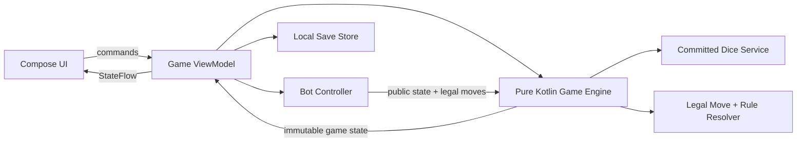

# Mummy Ludo — Android product and technical plan

Status: approved V1 product baseline
Target: a simple, trustworthy, offline-first Android Ludo game

## 1. Product promise

Mummy Ludo is a fast local Ludo game for one to four people, with optional computer players. Its distinguishing promise is simple: the bot tries hard to win, but it uses exactly the same dice and legal-move rules as a human. No hidden rerolls, altered probabilities, illegal moves, or knowledge of future dice rolls.

The first release is local and offline:

- Solo against bots.
- Two, three, or four humans sharing one device placed where everyone can reach it.
- Bots can fill otherwise unused color seats.
- A clean 15×15 classic cross board.
- Saved games that can resume after the app closes.

Online multiplayer, accounts, chat, ads, purchases, tournaments, and cosmetic stores are deliberately outside V1.

## 2. Match setup model

The board always has four color seats in the fixed clockwise turn order **Red → Green → Yellow → Blue**. Red is opposite Yellow; Green is opposite Blue.

The setup screen first asks for the number of humans: Solo, 2 Players, 3 Players, or 4 Players. “Player” means a human sharing the device; bots are added separately.

| Humans | Color ownership | Bot choices | Valid result |
|---|---|---|---|
| Solo, one color | Human owns 1 color | 1 mandatory opposite-color bot; 0–2 optional bots | 2–4 active colors |
| Solo, two colors | Human owns an opposite pair | 1 bot owns the other opposite pair | All 4 colors active |
| 2 players, one color each | Each human owns 1 color | 0–2 bots, one color each | 2–4 active colors |
| 2 players, two colors each | Each human owns an opposite pair | No free seats remain | All 4 colors active |
| 3 players | Each human owns 1 color | 0–1 bot | 3–4 active colors |
| 4 players | Each human owns 1 color | No free seats remain | All 4 colors active |

### Bot color assignment

In Solo one-color play, the mandatory opponent bot is assigned automatically to the human’s opposite color:

- Human Red → Bot Yellow.
- Human Yellow → Bot Red.
- Human Blue → Bot Green.
- Human Green → Bot Blue.

The human may then add bots to either or both remaining empty color seats. In two- and three-human one-color matches, optional bots occupy only the color seats left empty after the humans choose their colors.

### Two-color play

Two-color play is offered only for Solo and 2 Players.

- The selectable pairs are **Red + Yellow** and **Green + Blue**.
- A side owns eight tokens, four of each color.
- Turns advance in the fixed clockwise sequence **Red → Green → Yellow → Blue**. This gives each side two evenly spaced turns per round and prevents one side from moving either color on every roll.
- A side finishes and receives its rank only after all eight of its tokens reach their respective homes.
- When a color completes all four tokens, that color is silently skipped for the rest of the match: no die roll, handoff screen, empty turn, or turn animation is shown.
- In Solo two-color play, the mandatory opponent bot owns the other opposite pair. A second bot cannot be added because no color seats remain.

### Setup screen flow

1. Choose Solo / 2 Players / 3 Players / 4 Players.
2. For Solo or 2 Players, choose One Color or Two Colors.
3. Assign a name and color (or opposite color pair) to each human.
4. Add bots to empty seats; Solo cannot continue without a bot.
5. Review the rule summary and start.

Red is the anchor from which the opening turn is found, but Red does not have to be occupied. At match start the engine scans **Red → Green → Yellow → Blue** and gives the opening turn to the first active seat. For example, a Blue-versus-Green match opens with Green. Later turns continue in the same clockwise sequence while skipping inactive seats.

Invalid choices are prevented rather than shown as errors. Occupied colors and non-opposite two-color combinations are disabled, and Solo one-color play cannot start until the opposite-color bot is assigned.

## 3. Board selected for V1

Use the standard **15×15 cross-shaped Ludo board**:

- Red yard: top-left and the opening-order anchor.
- Green yard: top-right and second clockwise seat.
- Yellow yard: bottom-right and third clockwise seat.
- Blue yard: bottom-left and fourth clockwise seat.
- Opposite pairs: Red ↔ Yellow and Green ↔ Blue.
- Four tokens per color.
- A 52-cell shared outer track.
- A five-block colored home lane for each color. Landing exactly on the fifth block finishes that token; the token then moves into the center as a completion animation, not as a sixth playable step.
- Eight protected track squares: the four colored starting squares plus four star squares.

The board is rendered from logical coordinates, not a bitmap. This keeps token placement precise on phones and tablets, supports visual highlights, and allows themes later without changing game rules.

### Board visual standard

- The board remains a perfect square and scales to the available Android width from 320 dp upward; the gameplay screen must never require horizontal board scrolling.
- Each yard is a clean, solid color field with a contrasting inset home containing four large token positions. Track grid lines do not continue through the yards.
- The visual language is modern and restrained: softened true Ludo colors, rounded outer clipping, light track dividers, subtle depth on the inset homes and pawns, and no heavy black frame.
- The finish is one central square divided into four clean triangular color regions.
- Short route arrows begin on the first and fourth shared-track blocks after the colored starting square and end at the center of the immediately following block. Each short arrow therefore spans exactly two blocks.
- The home-entry arrow begins on the block immediately after the protected star and follows the corner route to the first square of that color's home lane. It is one continuous arrow spanning exactly four blocks.
- Direction arrows use thin, low-emphasis strokes and compact arrowheads so they guide movement without dominating the board.
- The board renderer derives arrows, stars, starts, lanes, and token centers from the same logical coordinates used by the rules engine, preventing visual and gameplay paths from drifting apart.

## 4. V1 rulebook (fixed “Classic” preset)

Ludo has many household variations, so V1 must display and consistently apply this exact preset:

1. Each color has four tokens in its yard.
2. The opening-turn scan always begins at Red and follows **Red → Green → Yellow → Blue**. The first active color found takes the opening turn; Red does not need to be active. Turns then continue clockwise in the same sequence, skipping inactive or completed colors.
3. A roll of 6 is required to place a yard token on its colored starting square.
4. Every valid roll of 6 is stored in the current turn's dice bank and requires another roll before any token moves.
5. Landing exactly on an arrow tail immediately moves the token or double token to that arrow's head. Merely passing over the tail does not activate it.
6. Activating an arrow earns one extra roll. If arrival at the arrow head also captures, the arrow and capture grant two extra rolls in total.
7. Landing on an eligible opponent unit on an unprotected square captures it and returns the captured token or tokens to their yard.
8. Each capture event earns exactly one extra roll, whether it returns one, two, or four tokens.
9. Arrow and capture bonus triggers accumulate independently and become additional rolls after the current dice bank is used.
10. When a non-6 ends the rolling sequence, the player chooses any stored die value, then chooses a legal token or double for that value. Used values leave the bank one at a time; the player chooses again until it is empty.
11. A third consecutive 6 cancels the turn: all three sixes and every other unused stored value are cleared, no token moves, and play advances immediately. Moves completed before that three-six sequence remain valid.
12. Starting squares and star-marked squares are protected. Tokens there cannot be captured; different colors may coexist there; and a yard token may enter its occupied starting square.
13. Two same-color tokens sharing a square may form one double token. No unit may contain more than two tokens.
14. A double token can move only on an even die result and travels half the rolled value: 2 moves one square, 4 moves two, and 6 moves three. An odd result cannot move that double.
15. Tokens may pass through a double token. Doubles are not blockades and do not prevent passage.
16. A single token can capture an opposing single but cannot capture an opposing double. A double can capture an opposing single or double.
17. Three same-color tokens on one square are represented as one double plus one single. On an unprotected square, an arriving opposing single captures only the exposed single; an arriving opposing double captures the opposing double and returns two tokens, leaving the single in place.
18. Four same-color tokens on one square are represented as two doubles. An arriving opposing double captures all four tokens in one capture event. An opposing single cannot capture any of them.
19. When a double reaches any protected safe square, it automatically becomes two singles. On a later move from that safe square, the player may select those two—or any two same-color tokens there—as a double and continue paired toward the next safe square.
20. A double may enter its own home lane and finish both tokens together. Its halved movement must land exactly on the fifth home-lane block.
21. After completing the shared track, a single or double enters only its own colored home lane.
22. Each colored home lane has five playable blocks. An exact landing on the fifth block finishes the participating token or pair and moves it into the center as a completion animation, not an additional playable step.
23. A move that would pass beyond the fifth home-lane block is illegal.
24. Finishing does not itself grant an extra roll; extra rolls come only from a 6, an activated arrow, or a capture.
25. If no unit can legally use a selected stored value, only that value is consumed. Other stored values and earned arrow/capture rolls remain available unless a third consecutive 6 cancelled the turn.
26. A participant finishes when all owned tokens are finished: four tokens in one-color play or eight tokens in two-color play. The participant is added to the ranking immediately and all owned color seats are silently skipped afterward.
27. Play continues after the first participant finishes. Each later finisher receives the next ranking position. When only one unfinished participant remains, that participant is assigned the final position and the match ends.

Future versions may offer optional house-rule switches, but V1 should have one deterministic rulebook so humans and bots are always judged by the same logic.

## 5. Gameplay experience

### Main screens

1. **Home** — New Game, Continue Game, How to Play, Settings, and update status when a release is available or ready to install.
2. **Match Setup** — human count, color mode, names/colors, bots, summary.
3. **Game Board** — board, current player/color, animated dice, legal-token highlights, and a direct Close action.
4. **Result** — complete finishing order, winner, rematch, home.
5. **How to Play** — visual rule cards for entry, arrows, doubles, capture, safety, and home.

### Turn interaction

- The active color is indicated by label, border/highlight, and icon.
- The player taps the die once. The result is committed to the game state immediately.
- A 6 stays visible in the dice bank and keeps the Roll action active. After the first non-6, every stored value is selectable; selecting a value highlights its legal tokens.
- Only legal tokens pulse/highlight; tapping any other token has no effect.
- Human moves are never forced merely because only one is legal; the player still selects the stored value and token.
- Movement is animated cell by cell, but the authoritative state updates independently of animation.
- There is no pass-the-phone handoff. The device is expected to remain between the local players, and the active color/player label changes immediately when the turn advances.
- There is no Pause screen or pause action. The Game Board top bar has a Close action; closing an active match asks for confirmation, then discards that match and returns Home.
- Tapping Roll commits the result first, then temporarily places the die over the board. It rolls and tumbles across several board regions for 800–950 ms, settles briefly on the committed value, and disappears before token selection or bot continuation. The die is not permanently displayed at the bottom of the screen, and repeated taps are blocked during the animation.
- The gameplay action area uses one concise status line only. Do not add secondary instructional text below states such as **Choose a token** or **[Bot name] is choosing…**.
- On capture, the captured unit retraces its route cell by cell to its colored starting square, then moves in one straight line to the exact center of its yard position. Its size remains constant; the moving pawn crossfades into the yard pawn at the same coordinates with no overshoot, shrink, or second movement.

### Token groups and crowded squares

- A single token uses the normal pawn treatment. A double uses two visibly paired pawns while acting as one selectable movement unit.
- A same-color pair has a distinct double-token treatment. Three same-color tokens render as one double plus one single; four render as two doubles. Four or more total tokens on a protected square use a compact segmented marker plus a numeric total. This supports the theoretical maximum of 16 tokens without hiding neighboring cells.
- Tapping a multi-token stack opens a bottom sheet listing movement units by color: singles and eligible doubles. Only legal units for the committed die are enabled; illegal and opponent units are read-only.
- The protected-star or starting-square identity remains visible behind or beside the stack marker. TalkBack announces the square type, token count by color, and which tokens are legal to move.
- Stack rendering, hit targets, and the selection sheet must remain usable at 320 dp board width and with large system text.

### Layout and device support

- Portrait-first layout; landscape supported by rearranging status and controls around the square board.
- Board scales to the available width without horizontal scrolling.
- Every color also has a symbol: Red circle, Blue square, Yellow star, Green triangle.
- Minimum target: Android 8.0 (API 26), with current Play-target API chosen when implementation begins.

## 6. Fair, win-seeking bot

### Non-cheating contract

The bot is an ordinary participant connected to the same rules engine as a human:

- The dice service generates and commits one result before either humans or bots choose a move.
- Bots receive only public game state, the committed die value, and the legal move list.
- Bots cannot call the random-number generator, reroll, alter state, skip rules, or see future rolls.
- The rules engine validates the bot’s selected move exactly as it validates a human move.
- Seeded matches can be replayed during tests to prove identical dice sequences and decisions.
- A developer-only match log records dice commits, legal moves, selected moves, and state hashes. It is never used to influence play.

### Bot decision system

Use a deterministic, bounded look-ahead bot rather than random choices. For every legal move it scores likely outcomes, then chooses the move with the highest estimated chance of eventually finishing first.

Evaluation factors:

- Finish a token or advance deep in the home lane.
- Capture an opponent.
- Avoid immediate capture risk.
- Move onto protected squares.
- Form, preserve, split, or capture doubles when that improves the winning outlook.
- Bring a new token onto the board when mobility is low.
- Advance total owned-token progress.
- Target the current leader when choices are otherwise close.
- Avoid leaving all tokens clustered or trapped.

For the first implementation, use heuristic scoring plus shallow chance-aware look-ahead over possible next dice values. Keep the search time capped (for example 150–300 ms on a typical device) and fall back to the best completed score. Fixed tie-breaking by token ID makes replays deterministic.

Difficulty can be added later without cheating: Easy chooses among reasonable moves with bounded randomness; Normal uses the base search; Hard searches deeper. Difficulty must never change dice odds.

### Bot validation

- Run at least 10,000 seeded bot-vs-bot matches in JVM tests.
- Assert that every selected move was present in the engine-provided legal list.
- Assert dice frequencies approach a uniform distribution and are independent of participant type.
- Run 10,000 seeded one-color head-to-head matches against a random legal-move bot using opposite seats. Split the suite evenly: 2,500 matches with the Normal bot as Red against Yellow, 2,500 as Yellow against Red, 2,500 as Blue against Green, and 2,500 as Green against Blue.
- Require the Normal bot to achieve at least a 50% aggregate first-place rate across that suite.
- Report results separately for every color seat and opposite pair to expose opening-order or board-position bias.
- Replay any failing seed exactly.

## 7. Android architecture

Recommended stack:

- Kotlin.
- Jetpack Compose and Material 3.
- A custom Compose board renderer backed by 15×15 logical coordinates.
- ViewModel + StateFlow for screen state.
- Navigation Compose for screens.
- Room or a small versioned local persistence layer for saved matches.
- Kotlin coroutines for bot computation and animations.

Keep the rules engine as a pure Kotlin module with no Android dependencies. The UI must send commands and render state; it must never decide whether a move is legal.



### Core model

```text
MatchConfig
  participants: List<Participant>
  seats: Map<Color, ParticipantId?>
  rules: RulePreset

Participant
  id, displayName, type(HUMAN|BOT), ownedColors

GameState
  phase, activeColor, turnSequence=[RED, GREEN, YELLOW, BLUE]
  consecutiveSixes
  committedDie, tokens, ranking, pendingBonusRolls, bonusEvents
  rngSeed, rngStep, revision

TokenState
  id, color, position(YARD|TRACK_INDEX|HOME_INDEX_1_TO_4|FINISHED)

Move
  tokenId, from, to, dieValue
```

Important separation:

- `DiceSource`: produces the next committed die value.
- `LegalMoveGenerator`: returns every allowed move for a state and die.
- `GameReducer`: validates a command and produces a new immutable state plus events.
- `BotPolicy`: chooses only from supplied legal moves.
- `BoardGeometry`: maps logical path positions to 15×15 display coordinates.
- `UpdatePromptStore`: persists the last prompted version, prompt time, and dismissal time without storing one-use Play update objects.

### App update mechanism

Production releases use the Google Play In-App Updates API through a small `UpdateCoordinator` wrapper around `AppUpdateManager`. The update UI observes a lifecycle-aware `StateFlow<UpdateState>` so Play-specific callbacks do not leak into Compose screens or game logic.

#### Update policy

- Check update availability when the Home screen starts and whenever the app returns to the foreground. Do not poll during every game turn. To prevent visual stutter, checks run asynchronously, caching the result without blocking UI thread initialization.
- Priority 0–1 releases do not interrupt the user. They remain available through normal Play auto-update and a manual **Check for updates** action in Settings/About.
- Priority 2–4 releases use the flexible update flow after the release has been available for at least two days. The update downloads in the background while the app remains usable.
- Priority 5 is reserved for critical security, data-loss, save-format, or game-breaking fixes and uses the immediate update flow when Play allows it.
- Update priority is set for each Play release and cannot be retroactively changed, so the release checklist must confirm it before rollout.
- If the user dismisses a flexible-update prompt, persist its `versionCode` and dismissal time and do not prompt automatically for that same version again for 72 hours. Continue showing a quiet update status in Settings/About. A manual **Check for updates**, an **Update ready** installation action, or a priority-5 immediate update is not subject to this cooldown.

#### Player experience and game safety

- Show update state inside the app first: **Update available**, download progress, **Update ready**, failure, or unavailable. Do not redirect immediately to the Play Store without explaining the status.
- A flexible update never interrupts an active match. When download completes, show a persistent **Update ready — restart when convenient** action on Home and Settings/About.
- Before starting any update flow or calling `completeUpdate()`, atomically save the last committed game revision, dice state, pending bonus rolls, ranking, and RNG position.
- If a flexible update becomes ready during a match, defer the restart until the player explicitly chooses it or returns to Home.
- For an immediate critical update, save the match first and then hand control to the Play update screen. After restart, read only the save metadata, preserve an untouched backup, run the required versioned migration, and validate the migrated revision before offering **Resume updated game**.
- Network or Play-service errors remain non-blocking. Offline gameplay must continue, and the app retries the availability check on a later foreground event.
- A migration failure keeps the original save untouched, hides **Continue Game** for the incompatible copy, and presents retry or recovery guidance rather than silently deleting or partially loading it.

#### Installation source and fallback

- In-app updates are supported only for compatible Google Play installations. The app must never download or self-install an APK.
- For a sideloaded, development, or otherwise unsupported installation, Settings/About displays **Updates unavailable for this installation** and may offer **View on Google Play** when the production listing exists.
- Keep `versionCode` strictly increasing for every uploaded bundle. Use a user-facing semantic `versionName` and display both version name and build number in Settings/About.
- Resume an immediate update found in `DEVELOPER_TRIGGERED_UPDATE_IN_PROGRESS` whenever the app returns to the foreground.

#### Update verification

- Unit-test update policy decisions with a fake update gateway: availability, priority, staleness, allowed update type, download progress, completion, cancellation, and failure.
- Verify that an active match is saved before flexible completion or immediate update launch and resumes at exactly the same committed revision afterward.
- Verify that flexible updates never force a restart during gameplay and that completed downloads remain visible until installed.
- Verify unsupported and offline installations remain fully playable and show the correct status-first fallback.
- Use Internal App Sharing to test basic availability, download, cancellation, completion, and restart behavior with the same application ID and signing key and a higher `versionCode`.
- Use a Play internal or closed testing track—not Internal App Sharing—to verify `inAppUpdatePriority`, staleness-based eligibility, and the priority 0–5 flexible-versus-immediate routing policy.

## 8. Testing plan

### Pure JVM tests

- Every color’s complete route, entry, home-lane transition, and exact finish on the fifth home-lane block with no sixth playable step.
- Arrow-tail activation, movement to every arrow head, pass-over behavior, and one arrow bonus credit.
- Single/double movement legality, odd-roll rejection, half-distance movement for 2/4/6, automatic safe-square splitting, optional re-pairing, and paired finishing.
- Capture, protected squares, occupied protected starts, and the full single/double/triple/four-token capture matrix.
- One bonus roll for every 6, arrow activation, and capture event, including accumulated combinations.
- Bonus-credit consumption, non-6 counter reset, and clearing all pending bonuses after a cancelled third consecutive 6.
- A rolled 6 still earns its bonus when no token can use that die result.
- No-legal-move turn passing.
- The opening scan starts at Red and selects the first active seat in Red → Green → Yellow → Blue order.
- Solo one-color assignment maps Red ↔ Yellow and Blue ↔ Green for the mandatory bot.
- Inactive-seat skipping in 2- and 3-color games without changing the fixed clockwise order.
- Silent skipping of every completed color without rolling, handoff, or animation.
- Opposite pair validation for two-color mode.
- Finish detection for four-token and eight-token participants, ranking each finisher, continued play, and automatic final-place assignment when one participant remains.
- State serialization and restoration at every turn phase.
- Property tests: tokens never leave valid routes; token counts never change; only active colors move.

### Android/UI tests

- Every setup combination in the table above.
- Solo cannot start without a bot.
- Solo one-color cannot start unless its mandatory bot owns the human’s opposite color.
- Illegal color pairs cannot be selected.
- Legal-token highlights match engine output.
- Protected-square stacks render correctly for 1, 2, 3, 4, and 16 tokens; remain inside one cell at 320 dp; preserve the safe-square marker; and expose the correct selectable tokens through the bottom sheet and TalkBack.
- Rotation/process recreation preserves the match.
- Human turns advance directly on the shared board with no handoff screen.
- Completed colors never display an empty turn.
- Close from an active match requires confirmation, discards the match on confirmation, and returns Home without showing a Pause screen.
- Dice input is disabled while the 800–950 ms board-roll animation runs, and the final face always equals the already committed engine result.
- Capture return animation follows the reverse track to the starting square, then one straight fixed-size movement into the exact yard circle with a seamless handoff.
- Flexible update progress and update-ready state survive recreation without interrupting an active match.
- Immediate and flexible update paths save and restore the exact committed game revision.
- Save migration completes and validates before any post-update resume action is shown; migration failure preserves the original save.
- A dismissed flexible-update prompt respects the 72-hour per-version cooldown, while manual checks, downloaded updates, and priority-5 updates bypass it.
- Unsupported Play installations show a status-first fallback and never attempt to self-install an APK.

## 9. Delivery phases

### Phase 1 — Rules foundation

Pure Kotlin state model, board geometry, deterministic dice source, legal moves, reducer, and exhaustive unit tests.

### Phase 2 — Playable local game

Compose board, tokens, dice interaction, movement/capture animations, one-color local matches, save/resume.

### Phase 3 — Flexible setup

Solo/2/3/4 human setup, bot seat filling, opposite two-color ownership, and direct shared-board turn transitions.

### Phase 4 — Bot and fairness proof

Heuristic/search bot, developer replay log, seeded simulations, baseline and color-bias reports.

### Phase 5 — Polish and release readiness

Tutorial, sound/haptics, performance, crash handling, Play in-app update integration, save-migration verification, app icon/store assets, signed release bundle, internal testing.

## 10. Acceptance criteria for V1

- Every setup combination listed in Section 2 can complete a full match.
- No invalid seat or color pairing can start.
- The opening scan is anchored at Red, selects the first active seat in Red → Green → Yellow → Blue order, and all later turns preserve that clockwise sequence while skipping inactive or completed seats.
- Humans and bots use the same dice results, legal move generator, and reducer.
- Sixes accumulate as selectable dice-bank values until a non-6 ends rolling; arrows and captures add later bonus rolls. A third consecutive 6 ends the turn and clears the bank and pending bonuses.
- A bot never produces an illegal move across 10,000+ seeded simulation matches.
- The Normal bot achieves at least a 50% aggregate first-place rate across 10,000 seeded head-to-head matches against a random legal-move bot, split evenly across Red-versus-Yellow, Yellow-versus-Red, Blue-versus-Green, and Green-versus-Blue assignments.
- Protected squares allow mixed-color occupancy and occupied-start deployment without capture; doubles never prevent passage on any square.
- Protected-square stacks remain legible and selectable from one through 16 tokens at the minimum supported board size.
- The match records every finishing position and ends only when one unfinished participant remains to be assigned last place.
- A killed or relaunched app resumes the last committed game state without duplicating a roll or move.
- Normal updates use a non-blocking flexible Play flow; only priority-5 critical releases may use the immediate flow.
- No update flow loses or advances the committed game state; migrations validate before resume; prompt cooldowns prevent repeated nagging; and unsupported/offline installations remain playable.
- Internal App Sharing validates the basic update lifecycle, while an internal or closed Play track validates priority and staleness policy.
- The board remains usable on the smallest supported phone and with large text.
- The exact V1 rule preset is reachable from setup and the How to Play page.

## 11. Competitive positioning

Large Ludo apps already advertise offline computer play and local shared-device play. Mummy Ludo should compete on clarity rather than feature volume:

- A visibly flexible “humans + bots + colors” setup instead of separate, confusing modes.
- A written bot fairness promise backed by deterministic replay tests.
- No login or network requirement for core play.
- A calm, family-friendly shared-device experience with no handoff interruption between turns.
- Clear house rules shown before and during the match.

Reference: [Ludo King Google Play listing](https://play.google.com/store/apps/details?id=com.ludo.king) and [Ludo Club](https://ludoclub.com.in/).

## 12. Decisions to revisit after the first playable build

- Whether one-color Solo should default to one bot (shorter) or three bots (full board).
- Whether Normal/Hard bot difficulty is needed at launch or one strong, transparent bot is enough.
- Whether the product name remains “Mummy Ludo.”
